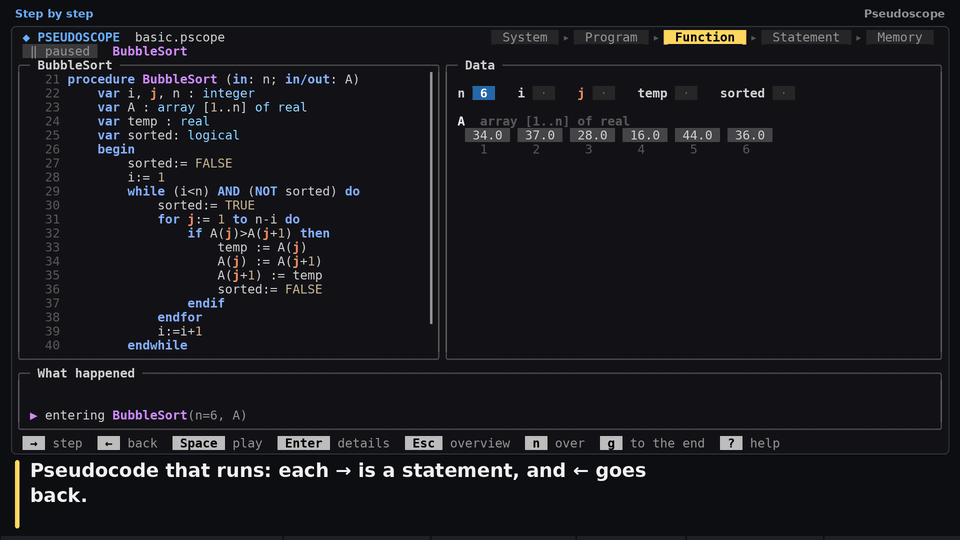

# Pseudoscope

*[English](README.md) · [Italiano](README.it.md) · [Português](README.pt.md)*

Pseudocódigo y diseños que cobran vida en el terminal. Escribe un algoritmo, unas clases,
un sistema distribuido o un diagrama; míralo funcionar paso a paso, hacia delante y hacia
atrás, desde fuera o con todo detalle; ponlo a prueba; tradúcelo a C, C++, Java, Rust,
TypeScript, JavaScript o Python.



## Qué hace

- **Ejecuta el pseudocódigo paso a paso**, hacia delante y hacia atrás, en cinco
  niveles: del diagrama de secuencia de todo un sistema a los bytes en memoria.
- **Lee el pseudocódigo que ya tienes**: P-like en todas sus grafías, PSeInt, VisuAlg,
  Portugol Studio y Cambridge, cada uno con sus bibliotecas de textos, números, archivos
  y dibujos.
- **Clases y herencia**: clases abstractas, interfaces, varias clases base; el método lo
  elige el objeto.
- **Sistemas**: componentes que intercambian mensajes por enlaces que los retrasan y los
  pierden, y pruebas que dicen qué debe ocurrir de un extremo al otro.
- **Diagramas para recorrer**: UML (secuencia, estados, actividad, clases, tiempos),
  Gantt, entidades y relaciones, mapas mentales, WBS, líneas de tiempo, en PlantUML,
  Mermaid y Graphviz.
- **Documentos**: los programas y diagramas que hay dentro de apuntes en Markdown y
  artículos en LaTeX se abren donde están.
- **Siete lenguajes**: C, C++, Java, Rust, TypeScript, JavaScript y Python, pruebas y
  simulación incluidas; lo que un lenguaje no sabe decir se rechaza explicando por qué.
- **En tu idioma**: interfaz, errores y ayuda en inglés, italiano, español y portugués.

Nació como un proyecto de primer curso para ejecutar P-like, el pseudocódigo que se
usaba en clase. Aquel pseudocódigo nunca tuvo una sintaxis fija, así que se
aceptan todas las grafías: `A[i,j]`, `A[i][j]` o `A(i,j)`, `and`, `.AND.` o `&&`, `end f`
o `endfunction`, y así sucesivamente.

## Compilar

Hace falta un compilador de C11, make y un sistema POSIX. Las pruebas necesitan también
Python 3.

```sh
git clone https://github.com/GritHat/pseudoscope
cd pseudoscope
make                 # bin/pseudoscope
make install         # opcional, PREFIX=/usr/local
```

## Empezar

```sh
bin/pseudoscope                           # la carpeta actual
bin/pseudoscope ui examples/sorting.pscope
tools/pseudoscope-window examples         # en una ventana nueva, con cualquier terminal
```

Los programas terminan en `.pscope` (`.plike` sigue valiendo), o en nada: un archivo es
lo que dicen sus primeras líneas.

Intro baja al detalle, Esc sube, `r` ejecuta, `t` lanza las pruebas, `?` enumera las
teclas. Funciona en kitty, GNOME Terminal, Ptyxis, Konsole, xterm y similares, en tmux y
screen, en la consola de Linux, y también sin colores o sin Unicode: ver
[docs/interface.md](docs/interface.md).

Habla inglés, italiano, español y portugués: el idioma del sistema, o `--lang=es`, o
`PSEUDOSCOPE_LANG=es`. Para añadir otro basta un archivo: ver
[docs/localization.md](docs/localization.md).

## Un programa, cinco niveles

El nivel decide qué se ve y cuánto dura un paso.

| Nivel | Se ve | Un paso es |
|---|---|---|
| Sistema | diagramas de secuencia, de estados, de tiempos y otros, en vivo | un mensaje |
| Programa | las llamadas, y quién espera a quién | una llamada o un retorno |
| Función | el código, o su diagrama de actividad, y sus datos: arreglos, listas, árboles | una instrucción |
| Instrucción | una expresión que se convierte en su valor | una operación |
| Memoria | el código C, direcciones, bytes | una lectura o una escritura |

Cualquier paso se puede deshacer. Cualquier subprograma se puede probar por separado,
con valores escritos o generados. Cada acceso se comprueba, y los errores dicen qué ha
pasado.

## Del primer programa a los sistemas distribuidos

| | Prueba | Mira |
|---|---|---|
| Ordenación | `examples/sorting.pscope` | nivel Función, `v` para barras, ← para volver |
| Recursión | `examples/fib.pscope` | nivel Programa |
| Listas y árboles | `examples/list.pscope`, `tree.pscope` | los punteros como flechas |
| Grafos | `examples/advanced/dijkstra.pscope` | las pruebas (`t`), que comprueban también una propiedad |
| Clases | `examples/advanced/stack_class.pscope` | Objetos |
| Herencia | `examples/advanced/shapes.pscope` | `T`: las mismas clases en cada lenguaje |
| Un diseño sin código | `examples/design/shop.pscope` | Secuencia |
| Un protocolo | `examples/systems/stop_and_wait.pscope` | qué pasa cuando se pierden paquetes |
| De extremo a extremo | `examples/systems/login.pscope` | una prueba, mientras se ejecuta |
| Consenso | `examples/systems/election.pscope` | Tiempos: quién manda, y cuándo |
| Encuentra el error | `examples/exercises/two_leaders.pscope` | ¿qué regla falta? Las pruebas lo muestran |
| UML | `examples/uml` | diagramas para recorrer |
| Planes, entidades, mapas mentales | `examples/diagrams` | un Gantt día a día |
| Apuntes y artículos | `examples/documents` | Markdown y LaTeX, abiertos como carpetas |
| Archivos y dibujos | `examples/libraries` | `d`: lo que dibuja un programa en Portugol |

Los componentes intercambian mensajes por enlaces que los retrasan y los pierden; las
pruebas dicen qué debe ocurrir de un extremo al otro:

```pascal
test "the right password logs in"
begin
    step "the user types the password"
    send Click(2, 2222) to client
    run
    expect client -> server: Login
    expect server -> client: Welcome
    check client.state = LoggedIn
end test
```

## Siete lenguajes

```sh
pseudoscope translate --to=java program.pscope     # o bien -o Program.java
pseudoscope run --to=python program.pscope
pseudoscope test --to=rust system.pscope           # las pruebas, traducidas
```

| | Las clases extienden | |
|---|---|---|
| C | nada | `float`, punteros, control de índices con `-b` |
| C++ | varias clases | referencias, `std::vector` |
| Java | una clase, e interfaces | lo que un subprograma cambia vuelve en un `record` |
| Rust | interfaces (traits) | tuplas; `unsafe` solo con variables globales y punteros |
| TypeScript, JavaScript | una clase, e interfaces | pasa `tsc --strict` |
| Python | varias clases | anotaciones de tipo, `abc` |

Lo que un lenguaje no sabe decir se rechaza explicando por qué, no se escribe mal. Se
traducen también componentes y pruebas, simulación incluida: una prueba da el mismo
resultado en los siete. `make targets` lo comprueba, programa por programa. Ver
[docs/translation.md](docs/translation.md).

## Línea de órdenes

```sh
pseudoscope exec program.pscope            # ejecuta, sin compilador de C
pseudoscope test program.pscope            # lanza sus pruebas
pseudoscope program.pscope -o program.c    # traduce a C (o .cpp .java .rs .ts .js .py)
pseudoscope run program.pscope             # compila y ejecuta
pseudoscope build program.pscope -o program
pseudoscope check program.psc             # solo informa de los errores
pseudoscope ast diagram.puml              # lo que ha entendido (--dot para Graphviz)
```

`exec`, `run` y `build` empiezan por un procedimiento llamado `main`, sin parámetros. `-`
lee la entrada estándar. `pseudoscope --help` enumera las opciones; estas eligen la
grafía de P-like:

| Opción | Valores | Por defecto |
|---|---|---|
| `-a`, `--assignment` | `colon-equals`, `equals` | `colon-equals` |
| `-i`, `--indexing` | `one`, `zero` | `one` |
| `-p`, `--params` | `decl`, `body`, `mixed` | `mixed` |
| `--operators` | `standard`, `dotted`, `mixed` | `mixed` |
| `-m`, `--mixed-arrays` | `true`, `false` | `true` |

`-b` añade el control de índices al programa generado.

## Límites

Los archivos, los dibujos y las demás funciones de biblioteca de los pseudocódigos se
ejecutan aquí y no se traducen. Los punteros a valores simples solo existen en C, C++ y
Rust. No se leen `algorithm2e` ni el teclado, el ratón y la red de Portugol Studio. Cada
documento dice qué más falta.

## Documentación

En inglés:

- [La interfaz](docs/interface.md)
- [El lenguaje](docs/language.md)
- [Sistemas: clases, componentes, pruebas](docs/systems.md)
- [Traducir: siete lenguajes](docs/translation.md)
- [Otros pseudocódigos](docs/dialects.md)
- [Diagramas y documentos](docs/diagrams.md)
- [Los idiomas: inglés, italiano, español, portugués, y cómo añadir otro](docs/localization.md)
- [Cómo funciona](docs/design.md)

## Pruebas

```sh
make test       # unidad, de extremo a extremo, pantallas, catálogos, encaje, sintaxis
make sanitize   # lo mismo, con el programa bajo ASan y UBSan
make targets    # cada programa en cada lenguaje cuyas herramientas estén instaladas
make fuzz       # programas y diagramas alterados, teclas al azar
```

## El vídeo

`tools/demo/make.py` graba la interfaz real, guiada por las teclas escritas en
`tools/demo/story.py`, y las órdenes reales: `--preview` hace el breve de arriba. La
música la escribe nota a nota `tools/demo/music.py`, así que no es de nadie más, y
`tools/demo/logo.py` dibuja el símbolo. El vídeo completo no está en el repositorio.

## Licencia

MIT
