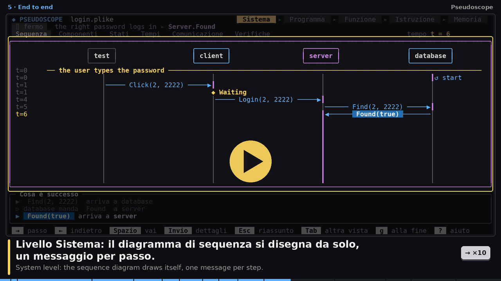

# Pseudoscope

*[English](README.md)*

Pseudocodice e progetti che prendono vita nel terminale. Si scrive un algoritmo, delle
classi, un sistema distribuito o un diagramma UML; lo si guarda girare passo per passo,
avanti e indietro, dall'esterno o in ogni dettaglio; lo si mette alla prova; lo si traduce
in C.

[](docs/demo/pseudoscope.mp4)

È nato come `plike-translator`, un progetto del primo anno per eseguire lo pseudocodice
usato a lezione. Quello pseudocodice non ha mai avuto una sintassi fissa, quindi si
accettano tutte le grafie: `A[i,j]`, `A[i][j]` o `A(i,j)`, `and`, `.AND.` o `&&`, `end f`
o `endfunction`, e così via. Ora legge anche PSeInt, VisuAlg, Portugol, lo pseudocodice di
Cambridge, PlantUML e Mermaid.

## Compilare

Servono un compilatore C11, make e un sistema POSIX. Per i test anche Python 3.

```sh
git clone https://github.com/GritHat/plike-translator
cd plike-translator
make                 # bin/pseudoscope
make install         # facoltativo, PREFIX=/usr/local
```

## Cominciare

```sh
bin/pseudoscope                           # la cartella corrente
bin/pseudoscope ui examples/sorting.plike
tools/pseudoscope-window examples         # in una finestra nuova, con qualsiasi terminale
```

Invio scende nel dettaglio, Esc risale, `r` esegue, `t` lancia le prove, `?` elenca i
tasti. L'interfaccia è in italiano; `--lang=en` per l'inglese. Funziona in kitty, GNOME
Terminal, Ptyxis, Konsole, xterm e simili, in tmux e screen, sulla console di Linux, e
anche senza colori o senza Unicode: vedi [docs/interface.md](docs/interface.md).

## Un programma, cinque livelli

Il livello decide che cosa si vede e quanto è lungo un passo.

| Livello | Si vede | Un passo è |
|---|---|---|
| Sistema | diagrammi di sequenza, di stato, dei tempi e altri, dal vivo | un messaggio |
| Programma | le chiamate, e chi aspetta chi | una chiamata o un ritorno |
| Funzione | il codice, o il suo diagramma di attività, e i dati: array, liste, alberi | un'istruzione |
| Istruzione | un'espressione che diventa il suo valore | un'operazione |
| Memoria | il codice C, gli indirizzi, i byte | una lettura o una scrittura |

Ogni passo si può annullare. Ogni sottoprogramma si può provare da solo, con valori
scritti a mano o generati. Ogni accesso è controllato, e gli errori dicono che cosa è
successo.

## Dal primo programma ai sistemi distribuiti

| | Prova | Guarda |
|---|---|---|
| Ordinamento | `examples/sorting.plike` | livello Funzione, `v` per le barre, ← per tornare indietro |
| Ricorsione | `examples/fib.plike` | livello Programma |
| Liste e alberi | `examples/list.plike`, `tree.plike` | i puntatori come frecce |
| Grafi | `examples/advanced/dijkstra.plike` | le prove (`t`), che verificano anche una proprietà |
| Classi | `examples/advanced/stack_class.plike` | Oggetti |
| Un progetto senza codice | `examples/design/shop.plike` | Sequenza |
| Un protocollo | `examples/systems/stop_and_wait.plike` | che cosa succede quando i pacchetti si perdono |
| End to end | `examples/systems/login.plike` | una prova, mentre gira |
| Consenso | `examples/systems/election.plike` | Tempi: chi comanda, e quando |
| Trova l'errore | `examples/exercises/two_leaders.plike` | quale regola manca? Le prove lo mostrano |
| UML | `examples/uml` | diagrammi da percorrere |

I componenti si scambiano messaggi su collegamenti che li ritardano e li perdono; le prove
dicono che cosa deve succedere da un capo all'altro:

```pascal
test "the right password logs in"
begin
    step "the user types the password"
    send Click(2, 2222) to client
    run
    expect client -> server: Login
    expect server -> client: Welcome
    check client.state = LoggedIn
end test
```

## Riga di comando

```sh
pseudoscope exec program.plike            # esegue, senza compilatore C
pseudoscope test program.plike            # lancia le sue prove
pseudoscope program.plike -o program.c    # traduce in C
pseudoscope run program.plike             # compila ed esegue
pseudoscope build program.plike -o program
pseudoscope check program.psc             # segnala solo gli errori
pseudoscope ast diagram.puml              # che cosa ha capito (--dot per Graphviz)
```

`exec`, `run` e `build` partono da una procedura chiamata `main`, senza parametri. `-`
legge lo standard input. `--lang=it` dà i messaggi in italiano. `pseudoscope --help`
elenca le opzioni; queste scelgono la grafia di P-like:

| Opzione | Valori | Predefinito |
|---|---|---|
| `-a`, `--assignment` | `colon-equals`, `equals` | `colon-equals` |
| `-i`, `--indexing` | `one`, `zero` | `one` |
| `-p`, `--params` | `decl`, `body`, `mixed` | `mixed` |
| `--operators` | `standard`, `dotted`, `mixed` | `mixed` |
| `-m`, `--mixed-arrays` | `true`, `false` | `true` |

`-b` aggiunge il controllo degli indici al programma generato. Il vecchio nome, `plike`,
funziona ancora.

## Limiti

Le classi non hanno ereditarietà. Componenti e prove si eseguono, non si traducono in C.
Dei diagrammi si leggono i tipi elencati in [docs/diagrams.md](docs/diagrams.md).

## Documentazione

In inglese:

- [L'interfaccia](docs/interface.md)
- [Il linguaggio](docs/language.md)
- [Sistemi: classi, componenti, prove](docs/systems.md)
- [Altri pseudocodici](docs/dialects.md)
- [Diagrammi](docs/diagrams.md)
- [Come funziona](docs/design.md)

## Test

```sh
make test       # test di unità, end to end, schermate, combinazioni di sintassi
make sanitize   # gli stessi, con il programma sotto ASan e UBSan
make fuzz       # programmi e diagrammi alterati, tasti a caso
```

## Licenza

MIT
