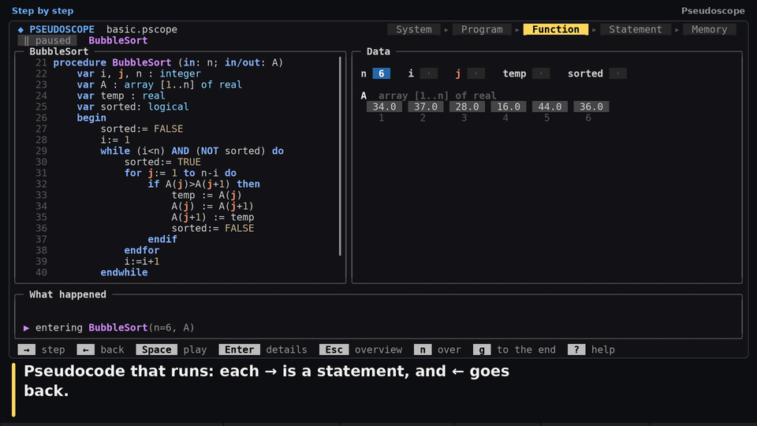

# Pseudoscope

*[Italiano](README.it.md)*

Pseudocode and designs, brought to life in the terminal. Write an algorithm, a set of
classes, a distributed system or a diagram; watch it run step by step, forwards and
backwards, from the outside or in every detail; test it; translate it to C, C++, Java,
Rust, TypeScript, JavaScript or Python.



## What it does

- **Runs pseudocode step by step**, forwards and backwards, at five levels: from the
  sequence diagram of a whole system down to the bytes in memory.
- **Reads the pseudocode you already have**: P-like in all its spellings, PSeInt,
  VisuAlg, Portugol Studio and Cambridge, each with its libraries for texts, numbers,
  files and drawings.
- **Classes and inheritance**: abstract classes, interfaces, several base classes; the
  object chooses its method.
- **Systems**: components that exchange messages over links that delay and lose them,
  and tests that say what must happen from one end to the other.
- **Diagrams to walk through**: UML (sequence, state, activity, classes, timing), Gantt
  charts, entities and relationships, mind maps, WBS, timelines, in PlantUML, Mermaid
  and Graphviz.
- **Documents**: the programs and diagrams inside Markdown notes and LaTeX papers open
  where they are.
- **Seven languages**: C, C++, Java, Rust, TypeScript, JavaScript and Python, tests and
  simulation included; what a language cannot say is refused with the reason.

It started as `plike-translator`, a first-year project to run the pseudocode used in our
lectures. That pseudocode never had a fixed syntax, so all the spellings are accepted:
`A[i,j]`, `A[i][j]` or `A(i,j)`, `and`, `.AND.` or `&&`, `end f` or `endfunction`, and so
on.

## Build

Needs a C11 compiler, make and a POSIX system. The tests also need Python 3.

```sh
git clone https://github.com/GritHat/plike-translator
cd plike-translator
make                 # bin/pseudoscope
make install         # optional, PREFIX=/usr/local
```

## Start

```sh
bin/pseudoscope                           # the current folder
bin/pseudoscope ui examples/sorting.pscope
tools/pseudoscope-window examples         # in a new window, whatever the terminal
```

Programs end in `.pscope` (`.plike` still works), or in nothing: a file is what its
first lines say it is.

Enter goes deeper, Esc comes back up, `r` runs, `t` tests, `?` lists the keys. It is in
Italian; `--lang=en` for English. It works in kitty, GNOME Terminal, Ptyxis, Konsole,
xterm and the like, in tmux and screen, on the Linux console, and without colours or
Unicode: see [docs/interface.md](docs/interface.md).

## One program, five levels

The level decides what you see and how long a step is.

| Level | You see | A step is |
|---|---|---|
| System | sequence, state, timing and other diagrams, live | a message |
| Program | the calls, and who waits for whom | a call or a return |
| Function | the code, or its activity diagram, and its data: arrays, lists, trees | a statement |
| Statement | an expression turning into its value | one operation |
| Memory | the C code, addresses, bytes | a read or a write |

Any step can be undone. Any subprogram can be tried by itself, with values you type or
have generated. Every access is checked, and errors say what happened.

## From the first program to distributed systems

| | Try | Look at |
|---|---|---|
| Sorting | `examples/sorting.pscope` | Function level, `v` for bars, ← to go back |
| Recursion | `examples/fib.pscope` | Program level |
| Lists and trees | `examples/list.pscope`, `tree.pscope` | pointers as arrows |
| Graphs | `examples/advanced/dijkstra.pscope` | the tests (`t`), which also check a property |
| Classes | `examples/advanced/stack_class.pscope` | Objects |
| Inheritance | `examples/advanced/shapes.pscope` | `T`: the same classes in each language |
| A design without code | `examples/design/shop.pscope` | Sequence |
| A protocol | `examples/systems/stop_and_wait.pscope` | what happens when packets get lost |
| End to end | `examples/systems/login.pscope` | a test, while it runs |
| Consensus | `examples/systems/election.pscope` | Timing: who leads, and when |
| Find the mistake | `examples/exercises/two_leaders.pscope` | which rule is missing? The tests show it |
| UML | `examples/uml` | diagrams, walked through |
| Plans, entities, mind maps | `examples/diagrams` | a Gantt chart day by day |
| Lecture notes and papers | `examples/documents` | Markdown and LaTeX, opened like folders |
| Files and drawings | `examples/libraries` | `d`: what a Portugol program draws |

Components exchange messages over links that delay and lose them; tests say what must
happen from one end to the other:

```pascal
test "the right password logs in"
begin
    step "the user types the password"
    send Click(2, 2222) to client
    run
    expect client -> server: Login
    expect server -> client: Welcome
    check client.state = LoggedIn
end test
```

## Seven languages

```sh
pseudoscope translate --to=java program.pscope     # or -o Program.java
pseudoscope run --to=python program.pscope
pseudoscope test --to=rust system.pscope           # the tests, translated
```

| | Classes extend | |
|---|---|---|
| C | nothing | `float`, pointers, bounds checks with `-b` |
| C++ | several classes | references, `std::vector` |
| Java | one class, and interfaces | what a subprogram changes comes back in a `record` |
| Rust | interfaces (traits) | tuples; `unsafe` only with globals and pointers |
| TypeScript, JavaScript | one class, and interfaces | passes `tsc --strict` |
| Python | several classes | type hints, `abc` |

What a language cannot say is refused with the reason, not written wrong. Components
and tests are translated too, simulation included: a test gives the same result in
all seven. `make targets` checks it, program by program. See
[docs/translation.md](docs/translation.md).

## Command line

```sh
pseudoscope exec program.pscope            # execute, without a C compiler
pseudoscope test program.pscope            # run its tests
pseudoscope program.pscope -o program.c    # translate to C (or .cpp .java .rs .ts .js .py)
pseudoscope run program.pscope             # compile and execute
pseudoscope build program.pscope -o program
pseudoscope check program.psc             # only report errors
pseudoscope ast diagram.puml              # what was understood (--dot for Graphviz)
```

`exec`, `run` and `build` start from a procedure called `main`, without parameters. `-`
reads the standard input. `pseudoscope --help` lists the options; these choose the
spelling of P-like:

| Option | Values | Default |
|---|---|---|
| `-a`, `--assignment` | `colon-equals`, `equals` | `colon-equals` |
| `-i`, `--indexing` | `one`, `zero` | `one` |
| `-p`, `--params` | `decl`, `body`, `mixed` | `mixed` |
| `--operators` | `standard`, `dotted`, `mixed` | `mixed` |
| `-m`, `--mixed-arrays` | `true`, `false` | `true` |

`-b` adds bounds checks to the generated program. The old name, `plike`, still works.

## Limits

Files, drawings and the other library functions of the pseudocodes run here and are not
translated. Pointers to plain values exist only in C, C++ and Rust. `algorithm2e` and
the keyboard, mouse and network of Portugol Studio are not read. Each document says
what else is missing.

## Documentation

- [The interface](docs/interface.md)
- [The language](docs/language.md)
- [Systems: classes, components, tests](docs/systems.md)
- [Translating: seven languages](docs/translation.md)
- [Other pseudocodes](docs/dialects.md)
- [Diagrams and documents](docs/diagrams.md)
- [How it works](docs/design.md)

## Tests

```sh
make test       # unit tests, end-to-end tests, screens, syntax matrix
make sanitize   # the same, with the program under ASan and UBSan
make targets    # every program in every language whose tools are installed
make fuzz       # mutated programs and diagrams, random keys
```

## The video

`tools/demo/make.py` films the real interface, driven by the keys in
`tools/demo/story.py`, and the real commands: `--preview` makes the short one above.
The music is written note by note by `tools/demo/music.py`, so it is nobody else's, and
`tools/demo/logo.py` draws the mark. The full tour is not kept in the repository.

## License

MIT
