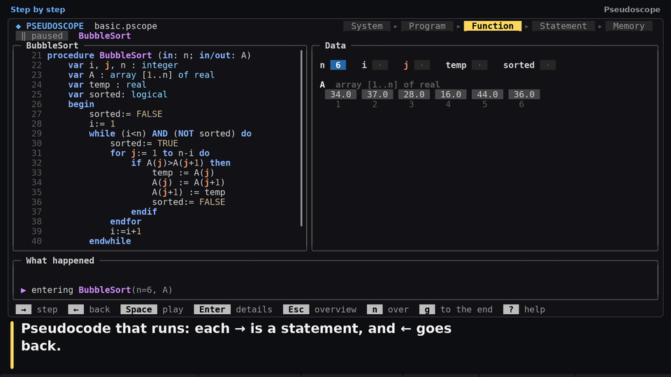

# Pseudoscope

*[English](README.md) · [Italiano](README.it.md) · [Español](README.es.md)*

Pseudocódigo e projetos que ganham vida no terminal. Escreva um algoritmo, algumas
classes, um sistema distribuído ou um diagrama; veja-o funcionar passo a passo, para a
frente e para trás, de fora ou em cada detalhe; teste-o; traduza-o para C, C++, Java,
Rust, TypeScript, JavaScript ou Python.



## O que faz

- **Executa o pseudocódigo passo a passo**, para a frente e para trás, em cinco níveis:
  do diagrama de sequência de um sistema inteiro aos bytes na memória.
- **Lê o pseudocódigo que você já tem**: P-like em todas as suas grafias, PSeInt,
  VisuAlg, Portugol Studio, Cambridge e o livro de Cormen, com suas bibliotecas de textos, números,
  arquivos e desenhos.
- **Classes e herança**: classes abstratas, interfaces, várias classes base; o método é
  escolhido pelo objeto.
- **Sistemas**: componentes que trocam mensagens por ligações que as atrasam e as
  perdem, e testes que dizem o que deve acontecer de uma ponta à outra.
- **Diagramas para percorrer**: UML (sequência, estados, atividade, classes, tempos),
  Gantt, entidades e relacionamentos, mapas mentais, EAP, linhas do tempo, em PlantUML,
  Mermaid e Graphviz.
- **Documentos**: os programas e diagramas dentro de anotações em Markdown e artigos em
  LaTeX se abrem onde estão.
- **Sete linguagens**: C, C++, Java, Rust, TypeScript, JavaScript e Python, testes e
  simulação incluídos; o que uma linguagem não sabe dizer é recusado com o motivo.
- **No seu idioma**: interface, erros e ajuda em inglês, italiano, espanhol e português.

Nasceu como um projeto de primeiro ano para executar o P-like, o pseudocódigo usado nas
nossas aulas. Aquele pseudocódigo nunca teve uma sintaxe fixa, por isso todas as grafias
são aceitas: `A[i,j]`, `A[i][j]` ou `A(i,j)`, `and`, `.AND.` ou `&&`, `end f` ou
`endfunction`, e assim por diante.

## Compilar

Precisa de um compilador C11, make e um sistema POSIX. Os testes precisam também de
Python 3.

```sh
git clone https://github.com/GritHat/pseudoscope
cd pseudoscope
make                 # bin/pseudoscope
make install         # opcional, PREFIX=/usr/local
```

## Começar

```sh
bin/pseudoscope                           # a pasta atual
bin/pseudoscope ui examples/sorting.pscope
tools/pseudoscope-window examples         # em uma janela nova, com qualquer terminal
```

Os programas terminam em `.pscope` (`.plike` continua valendo), ou em nada: um arquivo é
o que suas primeiras linhas dizem.

Enter desce ao detalhe, Esc sobe, `r` executa, `t` roda os testes, `?` lista as teclas.
Funciona no kitty, GNOME Terminal, Ptyxis, Konsole, xterm e similares, no tmux e no
screen, no console do Linux, e também sem cores ou sem Unicode: veja
[docs/interface.md](docs/interface.md).

Fala inglês, italiano, espanhol e português: o idioma do sistema, ou `--lang=pt`, ou
`PSEUDOSCOPE_LANG=pt`. Para acrescentar outro basta um arquivo: veja
[docs/localization.md](docs/localization.md).

## Um programa, cinco níveis

O nível decide o que se vê e quanto dura um passo.

| Nível | Vê-se | Um passo é |
|---|---|---|
| Sistema | diagramas de sequência, de estados, de tempos e outros, ao vivo | uma mensagem |
| Programa | as chamadas, e quem espera quem | uma chamada ou um retorno |
| Função | o código, ou seu diagrama de atividade, e seus dados: vetores, listas, árvores | uma instrução |
| Instrução | uma expressão que se torna seu valor | uma operação |
| Memória | o código C, endereços, bytes | uma leitura ou uma escrita |

Qualquer passo pode ser desfeito. Qualquer subprograma pode ser testado sozinho, com
valores digitados ou gerados. Cada acesso é verificado, e os erros dizem o que
aconteceu.

## Do primeiro programa aos sistemas distribuídos

| | Experimente | Veja |
|---|---|---|
| Ordenação | `examples/sorting.pscope` | nível Função, `v` para barras, ← para voltar |
| Recursão | `examples/fib.pscope` | nível Programa |
| Listas e árvores | `examples/list.pscope`, `tree.pscope` | os ponteiros como setas |
| Grafos | `examples/advanced/dijkstra.pscope` | os testes (`t`), que verificam também uma propriedade |
| Classes | `examples/advanced/stack_class.pscope` | Objetos |
| Herança | `examples/advanced/shapes.pscope` | `T`: as mesmas classes em cada linguagem |
| Um projeto sem código | `examples/design/shop.pscope` | Sequência |
| Um protocolo | `examples/systems/stop_and_wait.pscope` | o que acontece quando pacotes se perdem |
| De ponta a ponta | `examples/systems/login.pscope` | um teste, enquanto roda |
| Consenso | `examples/systems/election.pscope` | Tempos: quem lidera, e quando |
| Ache o erro | `examples/exercises/two_leaders.pscope` | que regra falta? Os testes mostram |
| UML | `examples/uml` | diagramas para percorrer |
| Planos, entidades, mapas mentais | `examples/diagrams` | um Gantt dia a dia |
| Anotações e artigos | `examples/documents` | Markdown e LaTeX, abertos como pastas |
| Arquivos e desenhos | `examples/libraries` | `d`: o que um programa em Portugol desenha |
| Como no livro de Cormen | `examples/cormen` | `r` sobre um procedimento: nada é declarado; `graphs.clrs` para conjuntos, `G.V` e `G.Adj[u]`, `btree.clrs` para os vetores dentro dos objetos, `heap.clrs` para `A.heap-size` e `S.top`, `kruskal.clrs` para as linhas que o livro escreve em palavras |

Os componentes trocam mensagens por ligações que as atrasam e as perdem; os testes dizem
o que deve acontecer de uma ponta à outra:

```pascal
test "the right password logs in"
begin
    step "the user types the password"
    send Click(2, 2222) to client
    run
    expect client -> server: Login
    expect server -> client: Welcome
    check client.state = LoggedIn
end test
```

## Sete linguagens

```sh
pseudoscope translate --to=java program.pscope     # ou então -o Program.java
pseudoscope run --to=python program.pscope
pseudoscope test --to=rust system.pscope           # os testes, traduzidos
```

| | As classes estendem | |
|---|---|---|
| C | nada | `float`, ponteiros, verificação de índices com `-b` |
| C++ | várias classes | referências, `std::vector` |
| Java | uma classe, e interfaces | o que um subprograma altera volta em um `record` |
| Rust | interfaces (traits) | tuplas; `unsafe` só com variáveis globais e ponteiros |
| TypeScript, JavaScript | uma classe, e interfaces | passa no `tsc --strict` |
| Python | várias classes | anotações de tipo, `abc` |

O que uma linguagem não sabe dizer é recusado com o motivo, não escrito errado. Os
componentes e os testes também são traduzidos, simulação incluída: um teste dá o mesmo
resultado nas sete. `make targets` verifica isso, programa por programa. Veja
[docs/translation.md](docs/translation.md).

## Linha de comando

```sh
pseudoscope exec program.pscope            # executa, sem compilador C
pseudoscope test program.pscope            # roda seus testes
pseudoscope program.pscope -o program.c    # traduz para C (ou .cpp .java .rs .ts .js .py)
pseudoscope run program.pscope             # compila e executa
pseudoscope build program.pscope -o program
pseudoscope check program.psc             # só informa os erros
pseudoscope ast diagram.puml              # o que foi entendido (--dot para Graphviz)
```

`exec`, `run` e `build` começam por um procedimento chamado `main`, sem parâmetros. `-`
lê a entrada padrão. `pseudoscope --help` lista as opções; estas escolhem a grafia do
P-like:

| Opção | Valores | Padrão |
|---|---|---|
| `-a`, `--assignment` | `colon-equals`, `equals` | `colon-equals` |
| `-i`, `--indexing` | `one`, `zero` | `one` |
| `-p`, `--params` | `decl`, `body`, `mixed` | `mixed` |
| `--operators` | `standard`, `dotted`, `mixed` | `mixed` |
| `-m`, `--mixed-arrays` | `true`, `false` | `true` |

`-b` acrescenta a verificação de índices ao programa gerado.

## Limites

Os arquivos, os desenhos e as outras funções de biblioteca dos pseudocódigos são
executados aqui e não são traduzidos. Os ponteiros para valores simples só existem em C,
C++ e Rust. Não se leem `algorithm2e` nem o teclado, o mouse e a rede do Portugol Studio.
Cada documento diz o que mais falta.

## Documentação

Em inglês:

- [A interface](docs/interface.md)
- [A linguagem](docs/language.md)
- [Sistemas: classes, componentes, testes](docs/systems.md)
- [Traduzir: sete linguagens](docs/translation.md)
- [Outros pseudocódigos](docs/dialects.md)
- [Diagramas e documentos](docs/diagrams.md)
- [Os idiomas: inglês, italiano, espanhol, português, e como acrescentar outro](docs/localization.md)
- [Como funciona](docs/design.md)

## Testes

```sh
make test       # unidade, de ponta a ponta, telas, catálogos, encaixe, sintaxe
make sanitize   # o mesmo, com o programa sob ASan e UBSan
make targets    # cada programa em cada linguagem cujas ferramentas estejam instaladas
make fuzz       # programas e diagramas alterados, teclas ao acaso
```

## O vídeo

`tools/demo/make.py` filma a interface real, guiada pelas teclas escritas em
`tools/demo/story.py`, e os comandos reais: `--preview` faz o curto acima. A música é
escrita nota por nota por `tools/demo/music.py`, portanto não é de mais ninguém, e
`tools/demo/logo.py` desenha o símbolo. O vídeo completo não fica no repositório.

## Licença

MIT
