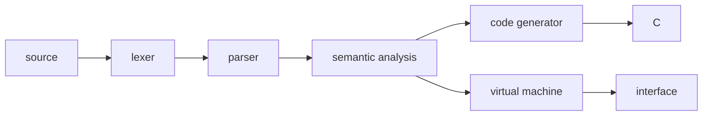

# Design

| Directory | Content |
|---|---|
| `src/front` | lexer, parser |
| `src/sema` | names, types, checks |
| `src/back` | C output, dumps of tokens and tree |
| `src/vm` | bytecode compiler and virtual machine |
| `src/tui` | the interface |
| `src/cli` | options, reading and writing files, running the C compiler |
| `src/util` | arena, string buffer, messages |

Everything that belongs to a translation lives in one arena, freed at the end.

**Parser.** Recursive descent on the list of tokens, without a symbol table. `a(i)` can
be a call or an array access, and the declaration may come later: the tree has a node
for "applied to", which the analysis settles. After a syntax error the parser skips to
the next statement, to report more than one error per run. Nesting is limited, so that
no input can exhaust the stack.

**Analysis.** Parameters are typed in two rounds, scalars first, because the bounds of
an array may use parameters that come after it. Types declared in the body for a
parameter, or for the function itself, are moved there before anything is resolved.
Names that clash with C are renamed; names the translator makes up never clash with
those of the program.

**Code generator.** Prints C with as few parentheses as readability allows. Two things
are not direct:

- C cannot write `float A[n][n]` before `n`. A matrix that comes before its sizes is
  passed as a plain pointer, and given its shape back at the beginning of the function.
- Bounds that are not constant are saved when the array comes into scope, because the
  variables they are made of may change.

**Virtual machine.** Bytecode in which some instructions mark where a statement, an
expression or a call begins or ends: those are the places to stop at, for each level of
detail. The whole state is a handful of arrays, so a snapshot is a few copies. Going back
means restoring the last snapshot before the target and executing again up to it; input,
output and history only ever grow, so doing it again writes the same things.

Memory is made of objects (a variable each) of slots (a number or pointer each). A pointer
is an object, an offset and a serial number, which tells when the object is gone.

**Interface.** `screen.c` draws cells and sends the ones that changed; it comes from
[reliable-over-unreliable](https://github.com/GritHat/reliable-over-unreliable). The views
only read: the state of a run is all in the virtual machine, so any of them can be drawn
at any moment.
