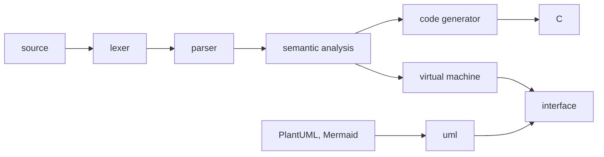

# Design

| Directory | Content |
|---|---|
| `src/front` | lexer, parser, the keywords of the other pseudocodes |
| `src/uml` | diagrams written as text: UML, and plans, entities, trees (`charts.inc`) |
| `src/sema` | names, types, checks |
| `src/back` | C output; the other languages (`emit.c`, `runtime.c`, `target.c`); dumps of tokens and tree |
| `src/vm` | bytecode compiler and virtual machine |
| `src/tui` | the interface |
| `src/cli` | options, reading and writing files, running the C compiler |
| `src/util` | arena, string buffer, messages |

Everything that belongs to a translation lives in one arena, freed at the end.

**Parser.** Recursive descent on the list of tokens, without a symbol table. `a(i)` can
be a call or an array access, and the declaration may come later: the tree has a node
for "applied to", which the analysis settles. After a syntax error the parser skips to
the next statement, to report more than one error per run. Nesting is limited, so that
no input can exhaust the stack.

**Other pseudocodes.** A table for each turns its words into the tokens of the language
(`dialect.c`); what is really different, such as declarations, has its own small parser
(`foreign.inc`). The tree is the same, so nothing after the parser knows which one it
was, except to infer the types that were not written.

**Analysis.** Parameters are typed in two rounds, scalars first, because the bounds of
an array may use parameters that come after it. Types declared in the body for a
parameter, or for the function itself, are moved there before anything is resolved.
Names that clash with C are renamed; names the translator makes up never clash with
those of the program.

**Code generator.** Prints C with as few parentheses as readability allows. Two things
are not direct:

- C cannot write `float A[n][n]` before `n`. A matrix that comes before its sizes is
  passed as a plain pointer, and given its shape back at the beginning of the function.
- Bounds that are not constant are saved when the array comes into scope, because the
  variables they are made of may change.

**The other languages.** One generator (`emit.c`) writes C++, Java, Rust, TypeScript,
JavaScript and Python: what changes is spelling, and three choices made once: arrays
are vectors that begin at 0, objects are references where the language has no others,
and what a subprogram changes for its caller is given back with its result where there
are no references to plain values. Every expression is written "as a value of the type
that is wanted": that is where conversions and copies go, so that the strict languages
get what they ask for. `target.c` first looks for what a language cannot say, and
refuses it with a reason. The simulation of components is a text per language
(`runtime.c`), the same algorithm with the same random numbers as the virtual machine:
`tests/targets.py` runs every program in every language and compares.

**Documents.** A block of a Markdown or LaTeX file is read as the whole file with
everything else blanked out, so that lines and columns are those of the document.
Algorithms in LaTeX are first turned, line for line, into one of the pseudocodes.

**Virtual machine.** Bytecode in which some instructions mark where a statement, an
expression or a call begins or ends: those are the places to stop at, for each level of
detail. The whole state is a handful of arrays, so a snapshot is a few copies. Going back
means restoring the last snapshot before the target and executing again up to it; input,
output and history only ever grow, so doing it again writes the same things.

Memory is made of objects (a variable each) of slots (a number or pointer each). A pointer
is an object, an offset and a serial number, which tells when the object is gone.

An object knows its class from the type of the variable it lives in, so a pointer or a
reference finds the method and the fields of what it really points to. Files and
drawings only grow, like the output, and their lengths are part of the state: going
back shortens them, going on writes the same things again.

Components add a queue of messages, ordered by time and then by arrival, and a generator
of pseudo-random numbers: both are part of the state, so a system can be run backwards
too. Every message, call and change of state is also a row of a list, which all of the
diagrams are drawn from.

**Interface.** `screen.c` draws cells and sends the ones that changed; it comes from
[reliable-over-unreliable](https://github.com/GritHat/reliable-over-unreliable). The views
only read: the state of a run is all in the virtual machine, so any of them can be drawn
at any moment. What a terminal cannot show (colours, characters) is replaced when a cell
is sent to it: the views do not know.
