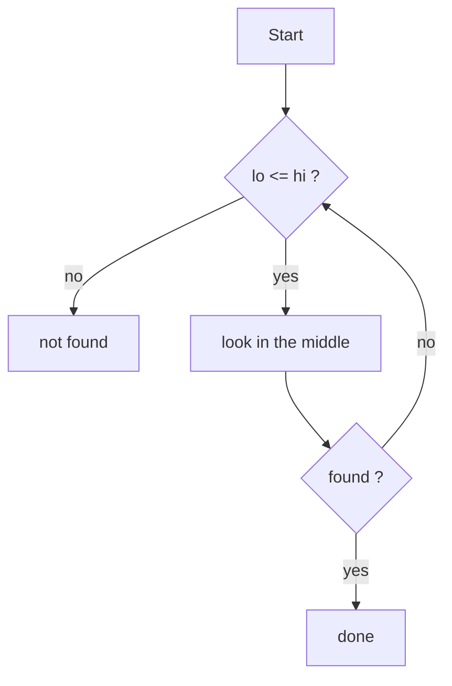
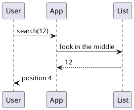
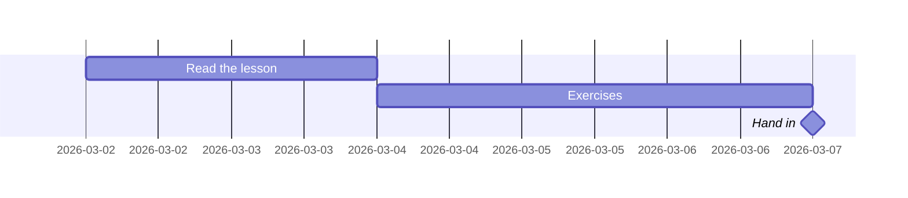

# Lesson 3: searching

Looking for a value in a list that is in order.

## The idea

Halve what is left at every step.



## The algorithm

```pseudocode
function search(in n: integer, in a[n]: array of integer, in x: integer): integer
var lo, hi, mid: integer
begin
    lo := 1
    hi := n
    search := 0
    while lo <= hi and search = 0 do
        mid := (lo + hi) / 2
        if a[mid] = x then
            search := mid
        elseif a[mid] < x then
            lo := mid + 1
        else
            hi := mid - 1
        endif
    endwhile
end search

procedure main()
var a: array [1..7] of integer
var i: integer
begin
    for i := 1 to 7 do
        a[i] := i * 3
    endfor
    print(search(7, a, 12), search(7, a, 13))
end main
```

## The same, as students in Spain would write it

```pseint
Algoritmo Cuenta
    total <- 0
    Para i <- 1 Hasta 4 Hacer
        total <- total + i
    FinPara
    Escribir total
FinAlgoritmo
```

## Who talks to whom



## Planning the homework


